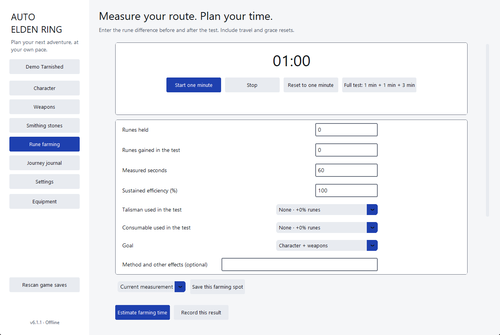

# Auto Elden Ring

**Un planificateur hors ligne pour Elden Ring.** Il calcule le coût exact en runes de ton
prochain niveau, de ta prochaine amélioration d'arme ou de ta prochaine pierre, estime le
temps de farm nécessaire pour atteindre un objectif, tient une chronologie datée pour chaque
personnage, et lit tes fichiers de sauvegarde PC sans jamais les modifier.

🇬🇧 [Read in English](README.md) · 📖 [Présentation complète](docs/PROJECT.fr.md) · ⬇️ [Télécharger](https://github.com/extrapirattaz/auto-elden-ring/releases/latest)

## Ce que ça fait

- **Coûts exacts.** Coûts des niveaux, des améliorations d'armes et des pierres, issus des
  tables du jeu, y compris le prix de la prochaine amélioration à partir d'un devis.
- **Planification.** Fixe une cible et vois ce qui est abordable et ce qu'il reste à farmer.
- **Farm de runes.** Mesure ton propre rythme, enregistre des lieux de farm, compare talismans et bonus.
- **Chronologies de personnage.** Checkpoints et événements personnalisés gardent un historique daté.
- **Import de sauvegarde.** Lit un fichier `.sl2` ou `.co2` en lecture seule, et l'actualise à tout moment.
- **Fenêtre compagnon.** Une petite fenêtre toujours au premier plan avec tes objectifs.

La liste complète des fonctionnalités est dans [docs/PROJECT.fr.md](docs/PROJECT.fr.md).

## Deux styles

L'application propose deux styles visuels. Choisis-le dans les **Paramètres**.

### Lisible — le style par défaut

Texte noir sur blanc, bordures visibles et un seul accent bleu. Conçu pour une lecture
rapide à côté du jeu, avec le contraste le plus élevé des deux styles.

### Carnet — le journal de voyage sombre

Un style sombre avec des titres en serif, des cartes filetées et un accent laiton, pour une
ambiance plus calme en faible lumière.

### Farm de runes

La page de farm mesure tes runes par minute et estime le temps jusqu'à ton objectif.

## Télécharger et lancer

- **Sans Python :** télécharge `Auto-Elden-Ring-<version>-win-x64.exe` depuis la
  [page des releases](https://github.com/extrapirattaz/auto-elden-ring/releases). Compare-le avec
  le SHA-256 de `SHA256SUMS.txt` avant de le lancer.
- **Depuis les sources :** installe Python 3.14 (64 bits), puis lance `START_AUTO_ELDEN_RING.bat`,
  ou lance `python main.py` après `python -m pip install -r requirements.txt`.

Nécessite Windows 10 ou 11, 64 bits. L'installation des dépendances demande une connexion
internet ; l'utilisation de l'application non.

Six langues sont disponibles : anglais (par défaut), français, tchèque, allemand, espagnol et
japonais. L'interface propose aussi un mode lecture pour les lecteurs dyslexiques.

## Tes données

Tout reste sur ton ordinateur. La progression est enregistrée dans
`%LOCALAPPDATA%/AutoEldenRing/profiles-v3.json` ; sauvegarde ce fichier pour garder ton historique.
L'application n'a aucun accès réseau, aucune télémétrie et aucun compte.

## Versions

- Chaque release est un tag (`v1.0.1` à `v7.0.0`) avec son exécutable Windows et ses sommes de contrôle.
  Les notes de version sont dans [CHANGELOG.md](CHANGELOG.md).
- `main` contient la version actuelle (7.0.0).
- `legacy/6.x` conserve la dernière version avec les styles Gothique et Windows XP, pour qui les préférait.

## Documentation

- [Présentation complète (français)](docs/PROJECT.fr.md) · [Full project overview (English)](docs/PROJECT.md)
- [Guide d'utilisation](docs/GUIDE.md) — chaque écran et chaque parcours (en anglais).
- [Sources des données](docs/SOURCES.md) — d'où viennent les tables de coûts, les icônes et les noms.
- [Journal des modifications](CHANGELOG.md) — toutes les versions.

## Avertissement

Auto Elden Ring est un outil de fans non officiel. Il n'est ni affilié, ni approuvé, ni
sponsorisé par FromSoftware, Bandai Namco Entertainment ou leurs partenaires. *Elden Ring*
et tous les noms et médias du jeu appartiennent à leurs ayants droit.

## Licence

Publié sous [licence MIT](LICENSE). Copyright (c) 2026 extrapirattaz.
La licence MIT couvre le code source de ce dépôt ; les médias du jeu gardent leurs propres
droits — voir [docs/SOURCES.md](docs/SOURCES.md).
