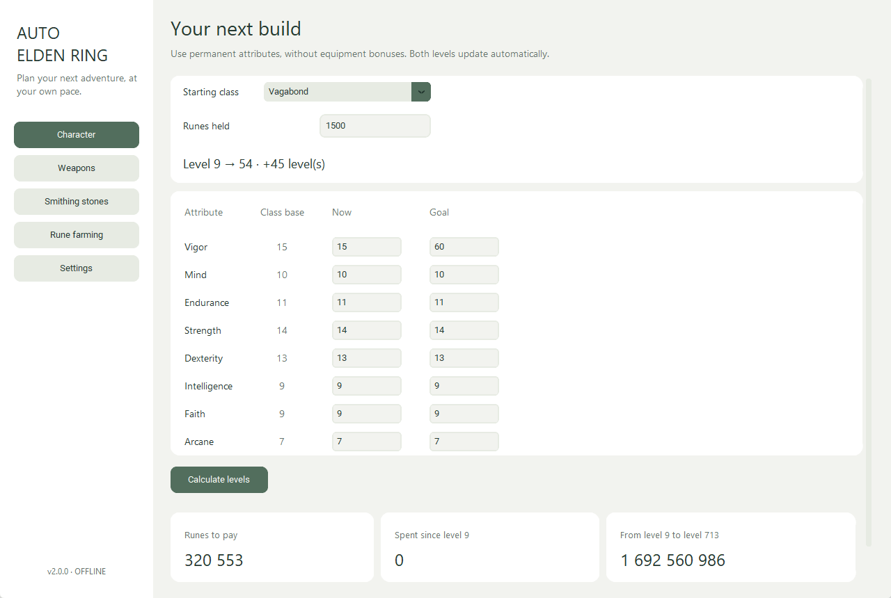
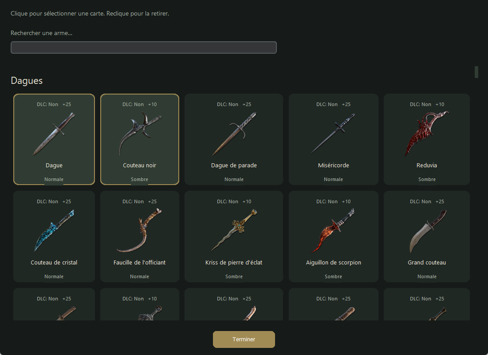

# Auto Elden Ring

A calm, offline Windows companion for character levels, weapon upgrades,
smithing materials and rune farming. Written in Python with a standalone x64 EXE.

## Run version 2.0.0

- Without Python: run Auto-Elden-Ring-2.0.0-win-x64.exe from the Windows ZIP.
  Images, fonts, translations and cost tables are included. No installation,
  browser, game connection or online account is required.
- From source: install Python 3.14 x64 and run START_AUTO_ELDEN_RING.bat.
  The launcher creates a local virtual environment and installs pinned dependencies.
  Alternatively, install requirements.txt with pip and run main.py.
  Dependency installation needs internet; using the application does not.

English is the default language. Settings also offers French, Czech, German,
Spanish and Japanese, with Calm, Elden Night and Slate themes.

## Plan your build

- Character: choose a class, enter permanent current and target attributes and
  held runes. Levels update automatically. One calculation shows remaining costs,
  spending since the class level, cost to 713, affordable levels and leftover runes.
- Weapons: enter the first upgrade price, or recover it from a next-upgrade quote.
  Alternatively, select several illustrated catalogue cards. Each weapon has its
  own current upgrade, target and copy count. Exact catalogue tariffs take priority.
- Materials: record owned stones and check off purchases. Purchases deduct runes
  and add stock; completed upgrades deduct forge runes and consume required stock.
  Surplus materials are preserved.
- Farm: measure one minute or complete 60 + 60 + 180 seconds. Each result keeps
  its own buffs and notes. Weighted rates predict time to your selected objective.
- Projects: save/open complete builds, keep saved attributes or update them, and
  confirm current runes and stones. Progress also saves locally.

There is no shopping cart. The planner assumes the relevant miner's bell bearings
are available. Ancient dragon stones have no purchase price or ordinary inventory
count; obtain them separately and confirm availability. Totals include the final
blacksmith fee but exclude a fictitious dragon-stone purchase price.

## Data and precision

The unchanged supplied elden_ring_costs.json declares regulation 1.17.1:
712 level transitions, 487 entries across 42 categories, 292 normal weapons,
194 somber weapons and one weapon that cannot be upgraded. Catalogue membership
does not independently establish availability in every edition.

Level and upgrade costs use integer tables. Manual profiles support unknown
weapons but have exceptions: select known catalogue weapons whenever possible.
Buff normalization and optimized farming rates are projections. Per-enemy
rounding, changing buffs and travel can affect earnings. Silver discovery buffs
contribute 0% to rune gains.

All 487 weapons have bundled icons and display names in all six languages.
Imported names and supplemental editorial translations are distinguished in
[SOURCES.md](docs/SOURCES.md). Czech is editorial localization. Coverage is
tested; native-speaker editorial review has not been performed.

Read the [guide](docs/GUIDE.md), [verification scope](docs/VERIFICATION.md)
and [changelog](CHANGELOG.md).

## Build and verify

Run BUILD_RELEASE.ps1 on Windows x64. The script tests calculations and real
widgets, builds a PyInstaller executable, checks embedded resources and creates:

- auto-elden-ring-2.0.0-source.zip: architecture-independent Python source.
- auto-elden-ring-2.0.0-windows-x64.zip: standalone Windows x64 package.
- Auto-Elden-Ring-2.0.0-win-x64.exe: executable for release downloads.
- RELEASE_MANIFEST.json, SHA256SUMS.txt and executable verification reports.

Each release lives in releases/version. Existing versions are never overwritten.
The version in auto_elden_ring/__init__.py owns the source/EXE correspondence.
Increment it before building another release. Version-1 projects use schema 1
and require version 1; version-2 projects use schema 2.

~~~powershell
python -m unittest discover -s tests -v
python main.py --self-test --report verification.json
python main.py --ui-smoke --report verification-ui.json
Get-FileHash .\Auto-Elden-Ring-2.0.0-win-x64.exe -Algorithm SHA256
~~~

Upload the project and artifacts to your own GitHub repository. No publishing
is performed here. The optional GitHub Actions workflow builds Windows releases
when you later push a matching version tag.

## Source layout

core.py contains exact costs; planner.py owns build state and explicit
transactions; ui.py renders the desktop; i18n.py holds interface translations;
storage.py validates and saves projects. assets contains bundled media and name
tables, tests verifies workflows, and scripts builds releases and maintains assets.
Source comments and documentation are in English.
