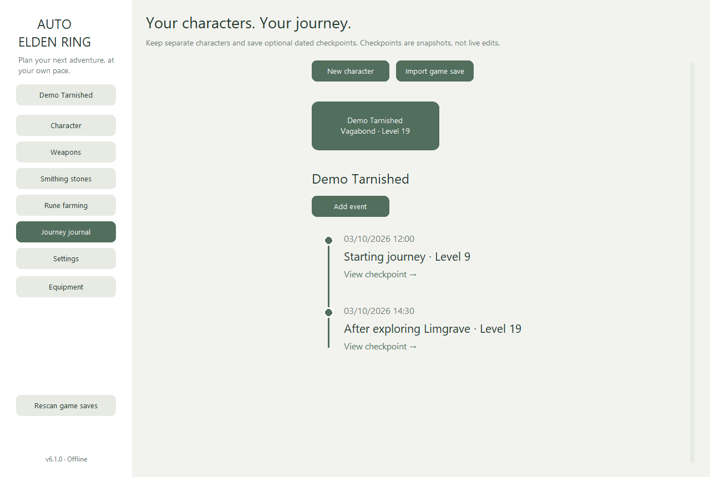
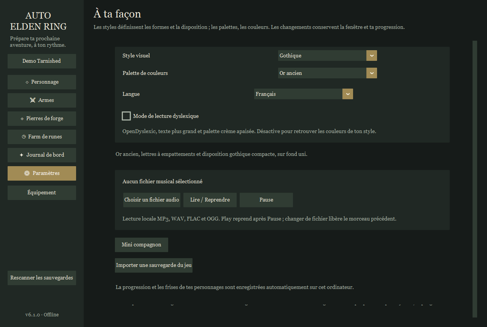
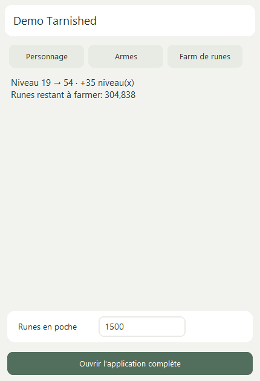

# Auto Elden Ring

A Windows companion for character levels, weapon upgrades, smithing materials,
rune farming and character timelines. Written in Python with a standalone x64 EXE.

## Run version 6.1.0

- Without Python: run Auto-Elden-Ring-6.1.0-win-x64.exe from the Windows ZIP.
  Images, translations, fonts and cost tables are included.
- From source: install Python 3.14 x64 and run START_AUTO_ELDEN_RING.bat, or install
  requirements.txt with pip and run main.py. First-time dependency installation
  needs internet; using the application does not.

English is the default language. French, Czech, German, Spanish and Japanese
are available in Settings. Modern has two palettes: Porcelain White and Charcoal
Black. Gothic keeps its serif lettering, compact layout and Antique Gold,
Ember and Moonlight colors on solid surfaces. Windows XP has one classic
blue/grey palette with square controls. No decorative backgrounds or animated
colors are loaded. Optional reading mode uses bundled
OpenDyslexic, larger text and a cream palette. Local MP3/WAV/FLAC/OGG playback is optional.

## Your characters and progress

The application opens maximized with an in-window character chooser. A fresh
installation contains no demo profiles. New characters remain saved locally on
future launches. Forms, imports, the catalogue, equipment and checkpoint details
use the same main window, with Back navigation.

Dropdowns use native menus. Settings update retained controls without hiding or
recreating the main window. The project layout and maintenance workflow are
documented in [Architecture](docs/ARCHITECTURE.md). To publish the source and each
matching Windows release, follow [GitHub publishing](docs/GITHUB_PUBLISHING.md).

Imported save files and the installation folder are remembered locally. Startup
checks the latest disk saves in a background worker. The **Rescan game saves**
button updates progression while keeping the current window and goals. It also
finds newly available saves in linked folders/roaming accounts. Only meaningful
changes add timeline events; repeated scans do not duplicate them. Manual
characters are kept. If an autosave is being written, reading retries briefly;
on failure the previous snapshot remains available. Unsaved game progress is
not available until the game writes it to disk.

The journal starts empty. Create a character using its in-game name and original
class, or import a PC save. Character cards open individual timelines.
The character name is also the journey name; its starting class is fixed.
Add current-progress snapshots or custom dated events with attributes and
acquired/upgraded weapons. Levels are derived from permanent attributes.
Confirming weapon upgrades automatically records a timeline event.

Import game save reads checksum-valid PC .sl2/.co2 files without modifying them.
Choose the installation folder to locate the roaming save, or select the file
directly. Imported names, starting classes, attributes, levels, held runes,
catalogue weapons/upgrades, armor, talismans, goods, key items and ordinary stones
populate each profile. Equipment displays the six weapon, four armor and four
talisman slots separately from all acquired weapons.
Inventory and storage counts are combined. Non-weapon item metadata and small
icons are bundled offline. Unresolved IDs remain visible; some new item names
fall back to English. Smithing bell bearings held in inventory are shown, while
delivery to the shop remains unverified.
Refresh from save records changes without duplicating unchanged snapshots.
The reader uses saved progress rather than live game memory.

## Calculate and farm

- Character: current/target attributes derive both levels. Calculate exact rune
  costs, spending since the class level, cost to 713 and affordable levels.
  Imported profiles already supply the class and current attributes.
- Weapons: enter the first upgrade price, invert a next-upgrade quote, or select
  illustrated catalogue cards. Each selected weapon keeps its own current/target
  upgrade and copy count. Imported owned upgrades initialize selected weapons.
- Materials: record stock and check off actual purchases. Held runes only
  calculate the farming deficit; they do not block an acknowledgement.
- Upgrades completed: confirm the in-game result. Weapon levels reach their
  targets, all recorded ordinary stones and held runes reset to zero, and a
  created character receives a journal event. Enter any actual surplus again.
- Farm: measure one minute or complete separate 60 + 60 + 180-second trials.
  Save named spots, reuse their weighted rates and compare rune buffs.
  Character and weapon planners can choose a recorded spot to estimate time.
- Small companion: an always-on-top window for character, weapons and farming
  objectives, with editable held runes. Inactive full-size pages are released;
  return to the full application at any time.

There is no shopping cart or save/open-build workflow. Local progress autosaves.
The planner assumes the relevant miner's bell bearings are available.
Ancient dragon stones have no fictitious purchase price or ordinary stock count.

## Data and precision

The unchanged supplied elden_ring_costs.json declares regulation 1.17.1:
712 level transitions and 487 catalogue entries across 42 categories.
Level costs and catalogue upgrade tariffs use integer tables.
Manual profiles can have exceptions; choose known catalogue weapons when possible.
Farming projections depend on route, downtime, rounding and buff uptime.
Silver discovery buffs contribute 0% to rune gains.

All 487 weapons have bundled icons and display names in six languages.
Editorial localization and game-media provenance are described in
[SOURCES.md](docs/SOURCES.md); native-speaker review has not been performed.
See the [guide](docs/GUIDE.md), [verification](docs/VERIFICATION.md) and
[changelog](CHANGELOG.md).

## Build and distribute

Run BUILD_RELEASE.ps1 on Windows x64. The builder tests real widgets/calculations,
builds the EXE, checks embedded resources and produces:

- auto-elden-ring-6.1.0-source.zip: architecture-independent Python source.
- auto-elden-ring-6.1.0-windows-x64.zip: standalone Windows x64 package.
- Auto-Elden-Ring-6.1.0-win-x64.exe: executable for release downloads.
- RELEASE_MANIFEST.json and SHA256SUMS.txt: artifact/source correspondence.

Each version lives in releases/version; existing versions are never overwritten.
The version in auto_elden_ring/__init__.py controls all three artifact names.
Source, comments and documentation are in English. Upload the files to your own
GitHub repository; no publishing is performed here. The optional Actions workflow
is manual and uploads build artifacts; it does not create GitHub Releases.
Native-menu input tests require an interactive Windows desktop; hosted Actions
execution has not been verified in this release.

Profiles and immutable snapshots save atomically to
%LOCALAPPDATA%/AutoEldenRing/profiles-v3.json. Back up that library for the full
history. Previous schema-2/3 states are migrated; schema-1 projects require version 1.
Save files are never copied into source archives or releases.

~~~powershell
python -m unittest discover -s tests -v
python main.py --self-test --report verification.json
python main.py --ui-smoke --report verification-ui.json
~~~

## Source layout and performance

core.py owns exact costs; planner.py owns calculations/state; ui.py, presentation.py
and journey_ui.py render the desktop; save_reader.py reads bounded PC save sections; save_sync.py rescans remembered files; history.py
imports changes; profiles.py saves timelines; i18n.py localizes controls.
The virtualized weapon gallery draws visible cards with a 64-image cache.
Theme/language updates preserve the visible native window and retained controls.
Catalogue opening measured 0.149 seconds and 58.89 MiB working
memory on this host. See verification for measurement limits.

