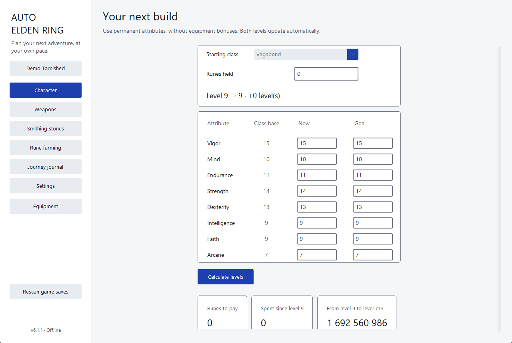
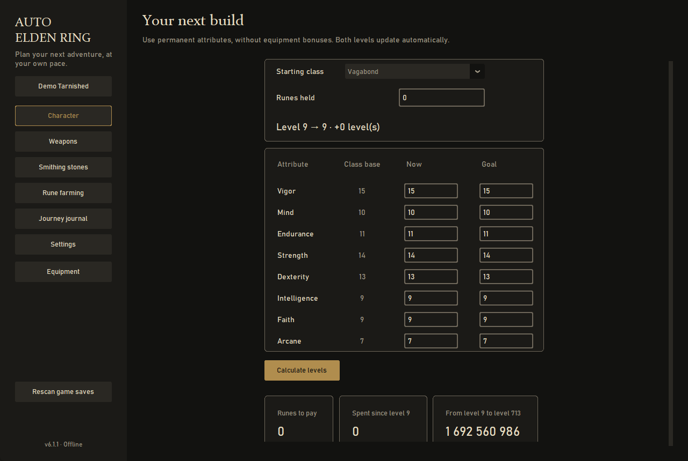

# Auto Elden Ring

**An offline Windows planner for Elden Ring characters, weapon upgrades, smithing
stones and rune farming.** It calculates exact costs from the supplied regulation
tables, keeps a timeline for each character and reads your PC save files without
changing them. Written in Python (Tkinter / CustomTkinter), distributed as a
standalone Windows x64 executable.

Full project overview, feature by feature: [docs/PROJECT.md](docs/PROJECT.md).

Keywords: Elden Ring, rune farming, build planner, level calculator, weapon upgrade
calculator, smithing stones, save file reader, offline, Windows, Python, CustomTkinter.

## Download and run

- **Without Python:** download `Auto-Elden-Ring-7.0.0-win-x64.exe` (or the Windows ZIP)
  from the [Releases page](../../releases). Images, translations, fonts and cost
  tables are included. Check the file against `SHA256SUMS.txt`.
- **From source:** install Python 3.14 x64, then either run `START_AUTO_ELDEN_RING.bat`
  or install the runtime dependencies with `python -m pip install -r requirements.txt`
  and run `python main.py`. Installing dependencies needs internet access; using the
  application does not.

English is the default language. French, Czech, German, Spanish and Japanese are
available in Settings.

## Features

**Characters and progress**
- A journal of characters, each with its own timeline of dated checkpoints and custom events.
- Import a PC save (`.sl2` / `.co2`) read-only: checksum-validated, never modified.
  Names, classes, attributes, levels, runes, weapons, armor, talismans and stones are
  imported; the installation folder or the save file can be chosen once and remembered.
- **Rescan game saves** updates progress while keeping the current window and your goals.
  Repeated scans do not duplicate timeline events.

**Calculations**
- **Character:** current and target attributes derive both levels; exact rune costs,
  spending since the class level, cost to level 713 and affordable levels.
- **Weapons:** enter the first upgrade price, invert a next-upgrade quote, or pick
  weapons from an illustrated catalogue. Each selected weapon keeps its own current
  and target upgrade and copy count.
- **Smithing stones:** record stock and check off purchases; held runes only calculate
  the farming deficit.
- **Rune farming:** measure one minute, or run the 60 + 60 + 180-second trial. Save
  named farming spots, reuse their weighted rates and compare rune buffs.
- **Small companion:** an always-on-top window with your current objectives and an
  editable rune count.

**Interface**
- Two visual styles, **Readable** (default: black text on white) and **Ledger** (a dark
  journal with serif headings and a brass accent). Each has one fixed palette.
- Reading mode for dyslexic readers: bundled OpenDyslexic font, larger text and a cream palette.
- Optional local MP3 / WAV / FLAC / OGG background music.
- Native Windows menus and dialogs; no internet connection is required.

## Data and precision

- `elden_ring_costs.json` is the supplied cost table, unchanged. It declares regulation
  1.17.1, with 712 level transitions and 487 catalogue entries across 42 categories.
- Level costs and catalogue upgrade tariffs use integer tables. Rational arithmetic and
  ties-to-even rounding follow the supplied helper model.
- Farming projections depend on route, downtime, rounding and buff uptime.
- Manual profiles can carry exceptions; choose known catalogue weapons when possible.
- The planner assumes the relevant miner's bell bearings are available. Ancient dragon
  stones have no invented purchase price or stock count.

Provenance of every data file, icon and localized name is documented in
[docs/SOURCES.md](docs/SOURCES.md). Editorial translations have not been reviewed by
native speakers; see the same file.

## Disclaimer

Auto Elden Ring is an unofficial fan tool. It is not affiliated with, endorsed by or
sponsored by FromSoftware, Bandai Namco Entertainment or any of their partners.
*Elden Ring* and all related names, images and game media belong to their owners.
The application reads only save files you own, never modifies the game and never
connects to the internet.

## Versions

Every released version is a tag (`v1.0.1` … `v7.0.0`) and a [GitHub release](../../releases)
with its Windows executable and checksums. Release notes are in [CHANGELOG.md](CHANGELOG.md).

- `main` is the current version (7.0.0).
- `legacy/6.x` keeps the last version with the earlier styles (Modern, Gothic and Windows XP
  with their palettes), for anyone who preferred them.

## Project layout

| Path | Responsibility |
| --- | --- |
| `main.py` | Entry point and the packaged verification commands |
| `auto_elden_ring/core.py` | Exact level and weapon costs, inverse costs, stone requirements |
| `auto_elden_ring/planner.py` | Character, weapon, budget, stock and farming state |
| `auto_elden_ring/ui.py`, `presentation.py`, `journey_ui.py` | Desktop windows, pages and the small companion |
| `auto_elden_ring/styles.py` | The two styles, their palettes and contrast helpers |
| `auto_elden_ring/save_reader.py`, `save_sync.py`, `history.py` | Read-only save parsing, rescans and history import |
| `auto_elden_ring/profiles.py`, `storage.py` | Atomic persistence, migrations and immutable snapshots |
| `auto_elden_ring/i18n.py`, `style_text.py`, `journey_text.py` | Six-language interface text |
| `classes_data.py`, `elden_ring_costs.json` | Starting classes and the supplied cost table |
| `assets/` | Icons, fonts, translations, provenance and licences |
| `tests/` | Calculation boundaries, save fixtures and widget workflows |
| `scripts/` | Release builder and an explicit local-data reset |
| `docs/` | User guide, architecture, verification and data sources |

## Build and test

Tests need Windows with an interactive desktop for the native-menu checks.

~~~powershell
python -m unittest discover -s tests -v
python main.py --self-test --report verification.json
python main.py --ui-smoke --report verification-ui.json
~~~

Release builds run `BUILD_RELEASE.ps1` on Windows x64 with Python 3.14. The builder runs
the tests, builds the executable with PyInstaller, checks the packaged executable and
writes a version-matched source ZIP, Windows ZIP, EXE and SHA-256 manifest into a
sibling `Release/<version>` folder. Existing releases are never overwritten. The
version in `auto_elden_ring/__init__.py` names all artifacts.

## Your data

Profiles and timelines are saved atomically to `%LOCALAPPDATA%/AutoEldenRing/profiles-v3.json`.
Back up that file to keep your full history. `python scripts/reset_local_data.py --confirm`
removes only the application's own state; it never deletes game saves, audio or custom images.
Save files are never copied into source archives or releases.

See the [guide](docs/GUIDE.md), [architecture](docs/ARCHITECTURE.md) and
[verification](docs/VERIFICATION.md) for details.

## License

Released under the [MIT License](LICENSE). Copyright (c) 2026 extrapirattaz.
The MIT License covers the source code in this repository. Game-related media and data
keep their own rights; see [docs/SOURCES.md](docs/SOURCES.md).
